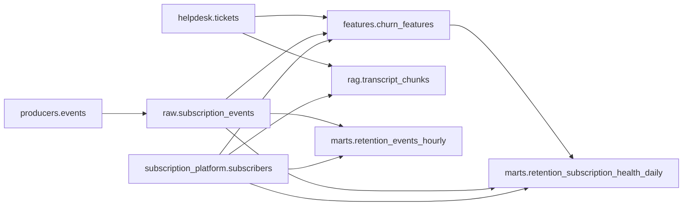

# Data Lineage — Subscription Health Data Product

_Generated by `scripts/validate_synthetic.py` from `synthetic/lineage.yaml`. Do not edit by hand.
Coverage is checked against every contract column and every source-table field._

## Dataset lineage

## Source systems

| Source table                        | System                                                                                                                 |
|:------------------------------------|:-----------------------------------------------------------------------------------------------------------------------|
| `producers.events`                  | Web/app SDK, billing webhooks, subscription-platform webhooks, ESP/SMS webhooks (producer payloads, event contract v1) |
| `subscription_platform.subscribers` | Subscription platform customer profile (PII-SUB-01, PII-SUB-02)                                                        |
| `commerce.orders`                   | Commerce order lines (PII-SUB-04)                                                                                      |
| `billing.payments`                  | Payment processor charge attempts (PII-BIL-03, PII-BIL-04)                                                             |
| `consent.ledger`                    | Consent management platform current state (PII-SUB-08)                                                                 |
| `helpdesk.tickets`                  | Helpdesk tickets and raw transcripts (PII-TRN-01)                                                                      |

## Field lineage

### `raw.subscription_events`

**Produced by:** `collector:managed_event_loader` · **Synthetic implementation:** `aurora_synthetic.transform.build_raw`

| Column        | Sources                          | Transformation                                                                      |
|:--------------|:---------------------------------|:------------------------------------------------------------------------------------|
| event_id      | `producers.events.event_id`      | Pass-through; producer UUIDv4, idempotency key                                      |
| event_type    | `producers.events.event_type`    | Pass-through; validated against the producer JSON Schema                            |
| source        | `producers.events.source`        | Pass-through                                                                        |
| event_time    | `producers.events.event_time`    | Parsed to UTC timestamp                                                             |
| ingested_at   | `system`                         | Stamped by the micro-batch loader at landing (ADR-003); not accepted from producers |
| subscriber_id | `producers.events.subscriber_id` | Pass-through surrogate key; null for anonymous traffic                              |
| anonymous_id  | `producers.events.anonymous_id`  | Pass-through (raw, C3); hashed in staging                                           |
| ip_address    | `producers.events.ip_address`    | Pass-through (raw, C3); dropped in staging (R-06)                                   |
| user_agent    | `producers.events.user_agent`    | Pass-through (raw, C3)                                                              |
| properties    | `producers.events.properties`    | JSON payload stored as text; DLP-scanned (GR-EVT-04)                                |

### `features.churn_features`

**Produced by:** `dbt:churn_features_v1` · **Synthetic implementation:** `aurora_synthetic.transform.feature_rows / build_features`

Every event-derived window uses incremental availability: an event counts for partition d only if ingested by d's last rebuild (d + 1 + A-OPS-03 days, 05:00).

| Column                | Sources                                                                    | Transformation                                                                                                                        |
|:----------------------|:---------------------------------------------------------------------------|:--------------------------------------------------------------------------------------------------------------------------------------|
| subscriber_id         | `subscription_platform.subscribers.subscriber_id`                          | One row per subscriber started on or before feature_date and not cancelled by it                                                      |
| feature_date          | `system`                                                                   | Weekly as-of dates ending yesterday; all windows close at end of this local date                                                      |
| tenure_days           | `subscription_platform.subscribers.created_at`                             | feature_date - created date                                                                                                           |
| plan_interval         | `subscription_platform.subscribers.plan_interval`                          | Pass-through                                                                                                                          |
| subscription_status   | `raw.subscription_events.event_type`, `raw.subscription_events.event_time` | Cancelled / paused (pause without resume in 28 d) / past_due (failed payment and no success in 7 d) / active; cancelled rows excluded |
| orders_90d            | `raw.subscription_events.event_type`                                       | Count of payment_succeeded in trailing 90 days                                                                                        |
| skips_90d             | `raw.subscription_events.event_type`                                       | Count of subscription_skipped in trailing 90 days                                                                                     |
| pauses_180d           | `raw.subscription_events.event_type`                                       | Count of subscription_paused in trailing 180 days                                                                                     |
| failed_payments_30d   | `raw.subscription_events.event_type`                                       | Count of payment_failed in trailing 30 days                                                                                           |
| sessions_30d          | `raw.subscription_events.source`, `raw.subscription_events.event_time`     | Distinct local days with web/app events in trailing 30 days                                                                           |
| cancel_page_views_14d | `raw.subscription_events.event_type`                                       | Count of cancel_page_view in trailing 14 days                                                                                         |
| email_open_rate_30d   | `raw.subscription_events.event_type`                                       | email_opened / email_sent in trailing 30 days, capped at 1; null with no sends                                                        |
| support_contacts_90d  | `helpdesk.tickets.opened_at`, `helpdesk.tickets.subscriber_id`             | Tickets opened in trailing 90 days                                                                                                    |
| days_since_last_order | `raw.subscription_events.event_type`, `raw.subscription_events.event_time` | feature_date - last payment_succeeded date; null if none                                                                              |
| label_churned_30d     | `raw.subscription_events.event_type`, `raw.subscription_events.event_time` | subscription_cancelled (voluntary or dunning) in (feature_date, feature_date + 30]; null until 30 days have passed                    |
| feature_version       | `system`                                                                   | Constant from the dbt model version                                                                                                   |
| _loaded_at            | `system`                                                                   | Publish time of the nightly build                                                                                                     |

### `marts.retention_subscription_health_daily`

**Produced by:** `dbt:retention_subscription_health_daily` · **Synthetic implementation:** `aurora_synthetic.transform.build_mart`

| Column                | Sources                                                                            | Transformation                                                                                                  |
|:----------------------|:-----------------------------------------------------------------------------------|:----------------------------------------------------------------------------------------------------------------|
| subscriber_id         | `subscription_platform.subscribers.subscriber_id`                                  | Started subscribers, not cancelled, or cancelled within 30 days of as_of_date                                   |
| as_of_date            | `system`                                                                           | Daily partitions for the last 14 days                                                                           |
| plan_interval         | `subscription_platform.subscribers.plan_interval`                                  | Pass-through                                                                                                    |
| subscription_status   | `raw.subscription_events.event_type`, `raw.subscription_events.event_time`         | Same derivation as features, including cancelled                                                                |
| tenure_days           | `subscription_platform.subscribers.created_at`                                     | as_of_date - created date                                                                                       |
| days_since_last_order | `features.churn_features.days_since_last_order`                                    | Same derivation as the feature, at as_of_date                                                                   |
| skips_90d             | `features.churn_features.skips_90d`                                                | Same derivation as the feature, at as_of_date                                                                   |
| failed_payments_30d   | `features.churn_features.failed_payments_30d`                                      | Same derivation as the feature, at as_of_date                                                                   |
| cancel_page_views_14d | `features.churn_features.cancel_page_views_14d`                                    | Same derivation as the feature, at as_of_date                                                                   |
| churn_risk_score      | `features.churn_features.tenure_days`, `features.churn_features.label_churned_30d` | Churn model (logistic regression trained on matured features) scored on as_of_date features; null for cancelled |
| churn_risk_band       | `marts.retention_subscription_health_daily.churn_risk_score`                       | low < 0.3 <= medium < 0.6 <= high                                                                               |
| ship_state            | `subscription_platform.subscribers.ship_state`                                     | State only; street, city and ZIP never leave staging                                                            |
| _loaded_at            | `system`                                                                           | Publish time of the partition's nightly build                                                                   |

### `marts.retention_events_hourly`

**Produced by:** `dbt:retention_events_hourly` · **Synthetic implementation:** `aurora_synthetic.transform.build_hourly`

| Column           | Sources                                        | Transformation                                                       |
|:-----------------|:-----------------------------------------------|:---------------------------------------------------------------------|
| event_hour       | `raw.subscription_events.event_time`           | UTC hour floor, last 7 days                                          |
| event_type       | `raw.subscription_events.event_type`           | Lifecycle event types only                                           |
| ship_state       | `subscription_platform.subscribers.ship_state` | State, or 'suppressed' when the cell has < 10 subscribers (ABAC-08)  |
| subscriber_count | `raw.subscription_events.subscriber_id`        | Distinct subscribers; cells still under 10 after roll-up are dropped |
| event_count      | `raw.subscription_events.event_id`             | Distinct events                                                      |
| _loaded_at       | `system`                                       | Publish time of the hourly build                                     |

### `rag.transcript_chunks`

**Produced by:** `dbt:rag_transcript_chunks` · **Synthetic implementation:** `aurora_synthetic.transform.build_chunks (redact + aurora_mlops.chunking.chunk_transcript)`

| Column              | Sources                                                                                                                                                                                                                | Transformation                                                                                                                          |
|:--------------------|:-----------------------------------------------------------------------------------------------------------------------------------------------------------------------------------------------------------------------|:----------------------------------------------------------------------------------------------------------------------------------------|
| chunk_id            | `helpdesk.tickets.ticket_id`                                                                                                                                                                                           | sha256(ticket_id | chunk_index | redaction_version)[:32]                                                                                |
| ticket_id           | `helpdesk.tickets.ticket_id`                                                                                                                                                                                           | Pass-through                                                                                                                            |
| subscriber_id       | `helpdesk.tickets.subscriber_id`                                                                                                                                                                                       | Pass-through surrogate key (consent and deletion only)                                                                                  |
| chunk_index         | `helpdesk.tickets.transcript_raw`                                                                                                                                                                                      | Position of the chunk within the ticket                                                                                                 |
| chunk_text_redacted | `helpdesk.tickets.transcript_raw`, `subscription_platform.subscribers.email`, `subscription_platform.subscribers.first_name`, `subscription_platform.subscribers.last_name`, `subscription_platform.subscribers.phone` | Redactor r1 (profile values, phones, grouped card numbers), boilerplate stripped, turn-aware chunks <= 512 tokens with one-turn overlap |
| token_count         | `rag.transcript_chunks.chunk_text_redacted`                                                                                                                                                                            | Approximate tokens (4 chars/token) until the embedding tokenizer is chosen                                                              |
| topic_tags          | `helpdesk.tickets.topic`                                                                                                                                                                                               | Ticket topic as a one-element array                                                                                                     |
| ticket_closed_at    | `helpdesk.tickets.closed_at`                                                                                                                                                                                           | UTC; retention clock for R-11                                                                                                           |
| redaction_version   | `system`                                                                                                                                                                                                               | Version of the redaction pipeline                                                                                                       |
| _loaded_at          | `system`                                                                                                                                                                                                               | Publish time of the nightly build                                                                                                       |
